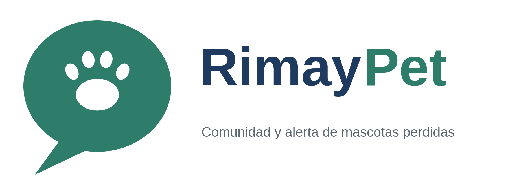

# RimayPet · Documentación de arquitectura

Red social para dueños de mascotas de Ayacucho, con alerta geolocalizada de mascotas perdidas. *Rimay* significa “hablar” en quechua.

**Curso:** Arquitectura de Software [IS-488] · Semestre 2026-II · UNSCH

## Decisiones principales

| Aspecto | Decisión |
|---|---|
| Estilo arquitectónico | Microservicios con comunicación orientada a eventos (Redis Pub/Sub) |
| Enfoque interno | Clean Architecture con cuatro capas (Dominio, Aplicación, Presentación, Infraestructura) |
| Entrada | API Gateway con JWT; PWA como cliente |
| Despliegue | Docker Compose en dos servidores de Oracle Cloud Free Tier |

## Contenido

| Carpeta | Contenido |
|---|---|
| `docs/00-propuesta` | Propuesta de arquitectura de software |
| `docs/01-analisis-de-sistema` | Actores, historias, requisitos, calidad, restricciones y drivers |
| `docs/02-arquitectura-software` | Arquitectura inicial |
| `docs/01-analisis-de-sistema` | (+ decisiones arquitectónicas) |
| `docs/02-arquitectura-software` | (+ estilo y enfoque arquitectónico) |
| `tecnologia/boilerplate-clean-architecture` | Ejemplo de Clean Architecture: dominio y aplicación |
| `docs/01-analisis-de-sistema` | (+ escenarios de calidad) |
| `docs/02-arquitectura-software` | (+ componentes arquitectónicos) |
| `docs/03-diseño-de-software` | Diseño interno, patrones y principios |
| `docs/04-modelo-c4` | Modelo C4, niveles 1 a 4 |
| `docs/trazabilidad.md` | De qué requisito sale cada componente |
| `tecnologia/boilerplate-clean-architecture` | (+ infraestructura, presentación y pruebas completas) |
