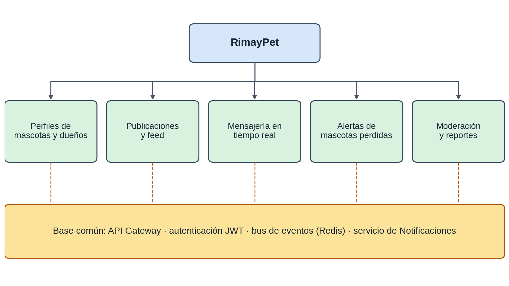
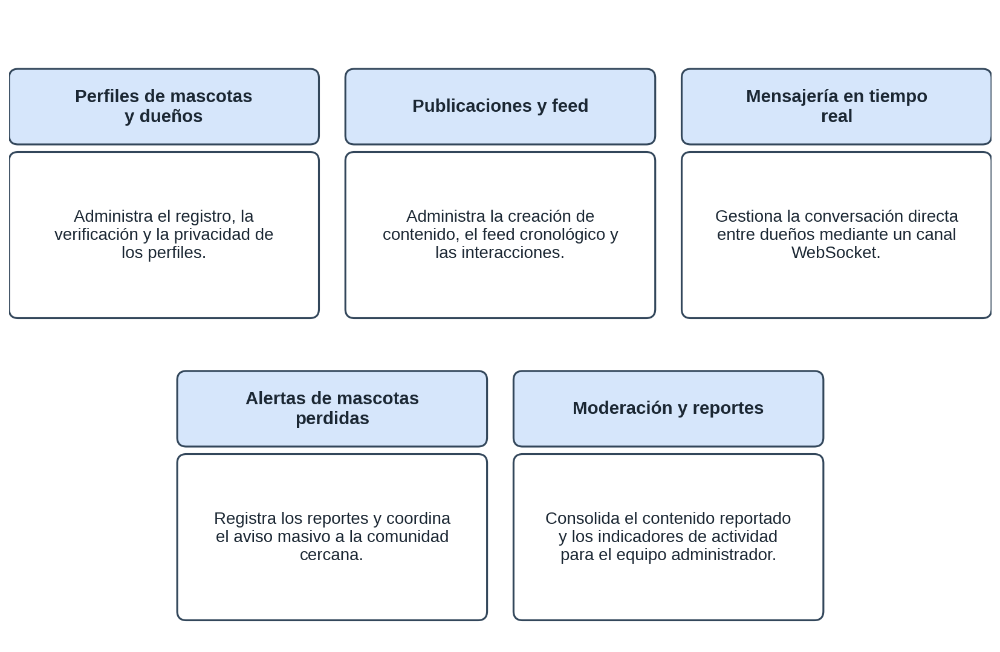
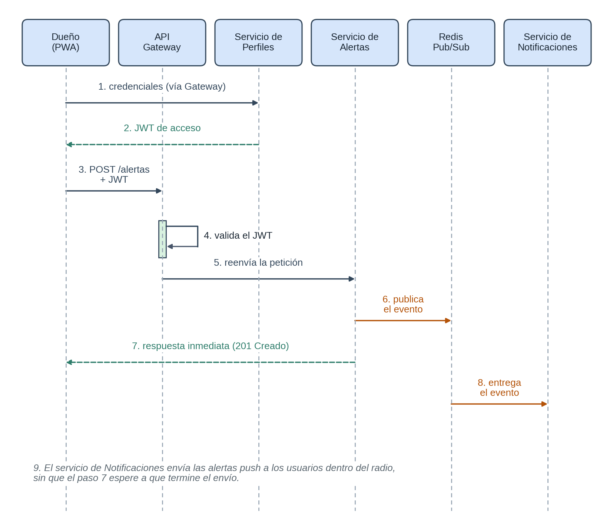

# Propuesta de arquitectura de software · RimayPet

RimayPet es una red social para dueños de mascotas de Ayacucho con alerta geolocalizada de mascotas perdidas. *Rimay* significa “hablar” en quechua.

## 1. Requerimientos del sistema

Levantamiento preliminar con dueños de mascotas, veterinarias y refugios de adopción de Ayacucho.

| Proceso | Requerimiento |
|---|---|
| **Gestión de perfiles** | Perfil de dueño y uno o más perfiles de mascota (nombre, especie, raza, edad, foto e historia). Verificación opcional con carnet de vacunación (insignia “verificado”). Privacidad configurable (público, solo seguidores o privado). Perfil expuesto como recurso REST reutilizable. |
| **Publicaciones y feed** | Fotos y videos cortos con descripción y ubicación opcional. Feed cronológico con paginación. Reacciones y comentarios en tiempo casi real. Medios servidos desde un CDN. |
| **Mensajería y notificaciones** | Mensajes directos en tiempo real por WebSocket. Notificaciones de reacciones, comentarios, seguidores y mensajes, incluidas notificaciones push. Alerta masiva dentro de un radio configurable sin bloquear la operación que la origina. |
| **Comunidad y descubrimiento** | Búsqueda por nombre, raza, especie y ubicación. Sugerencias de cuentas por raza y cercanía. Grupos temáticos. |
| **Mascotas perdidas** | Reporte con última ubicación, fotografía y características. Reporte de avistamientos que notifica al dueño. Estado (perdida, avistada, encontrada) consultable sin sesión mediante un enlace compartible. |
| **Administración y moderación** | Revisión de contenido reportado. Reportes de actividad. Suspensión temporal de cuentas. |
| **Seguridad y auditoría** | Todo por HTTPS. Contraseñas con bcrypt o Argon2. Bitácora de accesos administrativos y acciones de moderación. |

## 2. Alcance del proyecto

### Planteamiento del problema

El 64,0 % de los hogares peruanos tiene al menos una mascota, con mayor proporción en zonas rurales (72,7 %) que urbanas (61,8 %), y Ayacucho está entre las tres regiones con mayor proporción de hogares con gatos (47,8 %) (INEI, 2025). Aun así, quien pierde una mascota depende de canales informales y concentrados en Lima, y los dueños de ciudades como Ayacucho no tienen un espacio propio para construir comunidad. Esa brecha es el problema que RimayPet busca resolver.

> Fuente: Instituto Nacional de Estadística e Informática (INEI). (2025). *Tenencia y crianza de mascotas 2025* [Informe técnico]. ENAHO.

### Visión

Conectar a los dueños de mascotas de Ayacucho, y a futuro del Perú, en una comunidad digital donde compartan la vida de sus mascotas, encuentren apoyo y se reúnan con rapidez con una mascota perdida.

### Objetivos

- Ofrecer un espacio de comunidad enfocado en mascotas, con experiencia de red social.
- Reducir el tiempo de reunión entre una mascota perdida y su dueño mediante alertas geolocalizadas.
- Diseñar una arquitectura de microservicios que soporte el crecimiento sin degradar la experiencia.
- Demostrar, con presupuesto de infraestructura cero, tácticas de escalabilidad, disponibilidad y rendimiento para al menos 1000 usuarios registrados.
- Sentar las bases para integrar veterinarias, tiendas y refugios.

### Alcance

- Análisis, diseño y documentación de la arquitectura bajo un enfoque de microservicios, con modelo C4.
- Microservicios de Perfiles, Publicaciones y feed, Mensajería, Alertas y Notificaciones, con APIs REST y un canal WebSocket.
- API Gateway como punto único de entrada y autenticación.
- Alerta masiva geolocalizada con publicación y suscripción, sin bloquear la operación que la origina.
- Escenarios de calidad y tácticas, validados con pruebas de carga de 1000 usuarios concurrentes.
- Despliegue en más de un servidor con herramientas gratuitas (Docker, Docker Compose, GitHub Actions y Oracle Cloud Free Tier).

### Fuera de alcance

- Aplicaciones móviles nativas (se usa una PWA).
- Recomendación con aprendizaje automático avanzado.
- Verificación veterinaria automatizada (la validación es manual).
- Videollamadas o transmisión en vivo.
- Monetización.

## 3. Solución conceptual

### Esquema funcional y módulos

El módulo de Moderación y Reportes se aloja en el servicio de Perfiles para no multiplicar servicios, dado que una sola persona mantiene el sistema.

### Arquitectura técnica

| Componente | Descripción | Software | Hardware (pruebas) |
|---|---|---|---|
| Cliente web (PWA) | Interfaz de dueños y moderadores. | Navegador moderno | Laptop, PC o smartphone |
| API Gateway | Punto único de entrada y autenticación. | NGINX o Node.js, JWT, Docker | 2 vCPU, 2 GB RAM |
| Microservicios (Perfiles, Publicaciones, Mensajería y Alertas) | Una capacidad de negocio cada uno, con API REST propia. Mensajería expone además WebSocket. | Spring Boot, Node.js o FastAPI, Docker | 1 vCPU, 1 GB RAM por servicio |
| Servicio de Notificaciones | Se suscribe a eventos y envía notificaciones y alertas masivas. | Mismo stack, Docker | 1 vCPU, 1 GB RAM |
| Bus de eventos y caché | Comunicación asíncrona y caché del feed. | Redis (Pub/Sub) | 1 vCPU, 1 GB RAM |
| Servidor de base de datos | Una base independiente por servicio. | PostgreSQL 15 con PostGIS | 2 vCPU, 4 GB RAM, SSD |
| Almacenamiento de medios | Fotos y videos servidos por CDN. | Cloudflare R2 o Supabase Storage | Gestionado |
| CI/CD y despliegue | Pruebas, imágenes y despliegue. | Docker, Compose, GitHub Actions | Nivel gratuito o académico |

### Comunicación y seguridad

El servicio de Perfiles valida las credenciales y emite un JWT; el API Gateway lo valida en cada petición y al abrir el WebSocket. En la alerta de mascota perdida, Alertas publica un evento en Redis y Notificaciones lo consume de forma asíncrona, sin ralentizar la respuesta a quien reportó.

### Capas

| Capa | Descripción |
|---|---|
| Presentación | PWA (React, Angular o Vue) que consume las APIs REST y el canal en tiempo real. |
| Servicios (lógica de negocio) | Microservicios con APIs REST y WebSocket, y API Gateway para acceso y seguridad. |
| Datos | Base de datos por servicio y medios servidos por CDN. |

Cada microservicio escala de forma independiente, y los contenedores, la integración continua y más de un servidor garantizan despliegues reproducibles aun con infraestructura gratuita.
