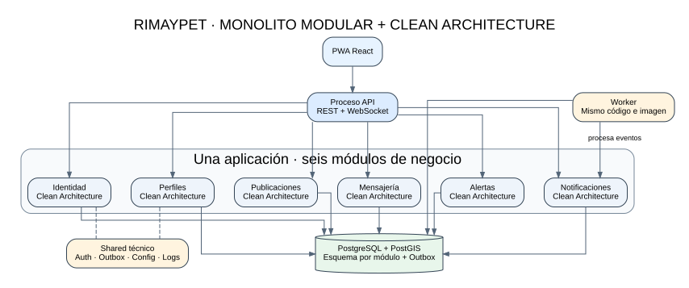

# Vista lógica inicial

RimayPet se organiza en una PWA, un monolito modular, un proceso worker del mismo código y una persistencia PostgreSQL con esquemas por módulo.

| Vista | Elementos |
|---|---|
| Presentación | PWA React, REST y WebSocket. |
| Aplicación | Seis módulos con fachadas públicas y casos de uso. |
| Dominio | Entidades y reglas independientes por módulo. |
| Infraestructura | Repositorios PostgreSQL/PostGIS, Outbox, R2 y Web Push. |
| Despliegue | Dos VM Oracle; API y worker en VM1, base en VM2; segunda API condicional. |

La vista de contenedores y las relaciones externas se detallan en `docs/04-modelo-c4/`.
