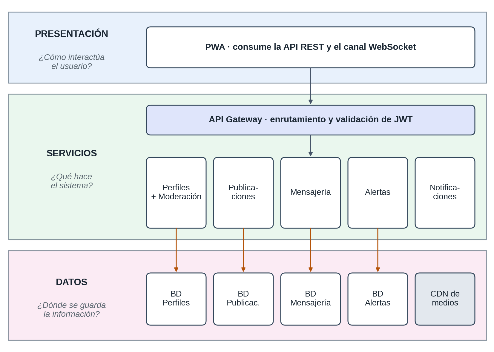
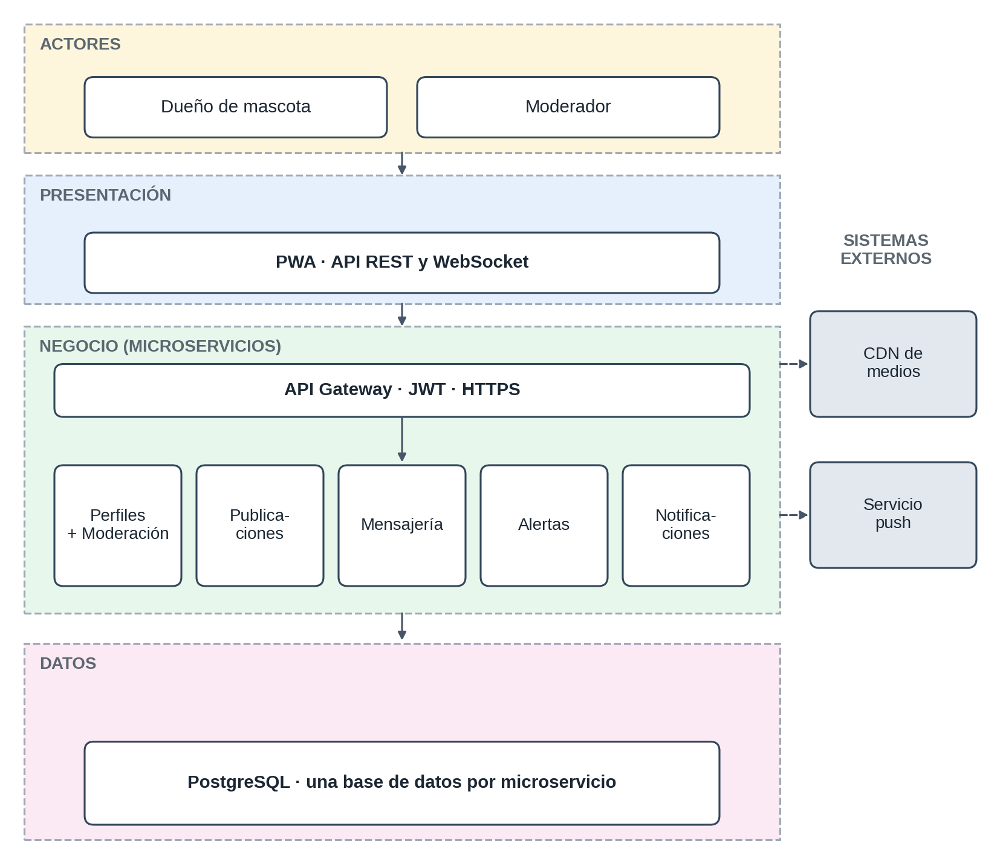
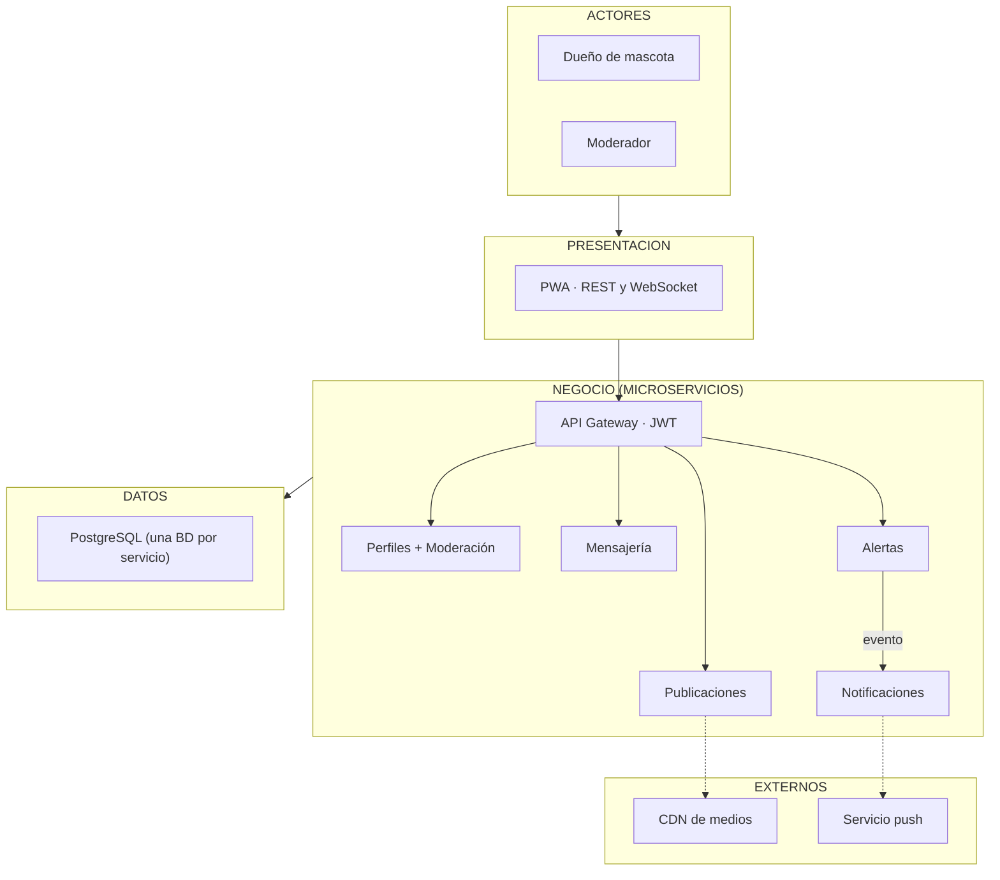

# Arquitectura inicial

A partir de los drivers (DA01 a DA06), la arquitectura organiza sus responsabilidades en tres capas.

| Capa | Pregunta que responde | Contenido |
|---|---|---|
| Presentación | ¿Cómo interactúa el usuario? | Aplicación web progresiva (PWA) que consume la API REST y el canal WebSocket. |
| Servicios (lógica de negocio) | ¿Qué hace el sistema? | Microservicios de Perfiles (con Moderación), Publicaciones, Mensajería, Alertas y Notificaciones, detrás de un API Gateway. |
| Datos | ¿Dónde se almacena la información? | Una base PostgreSQL por microservicio y el almacenamiento de medios en un CDN. |

## Diagrama integrado

