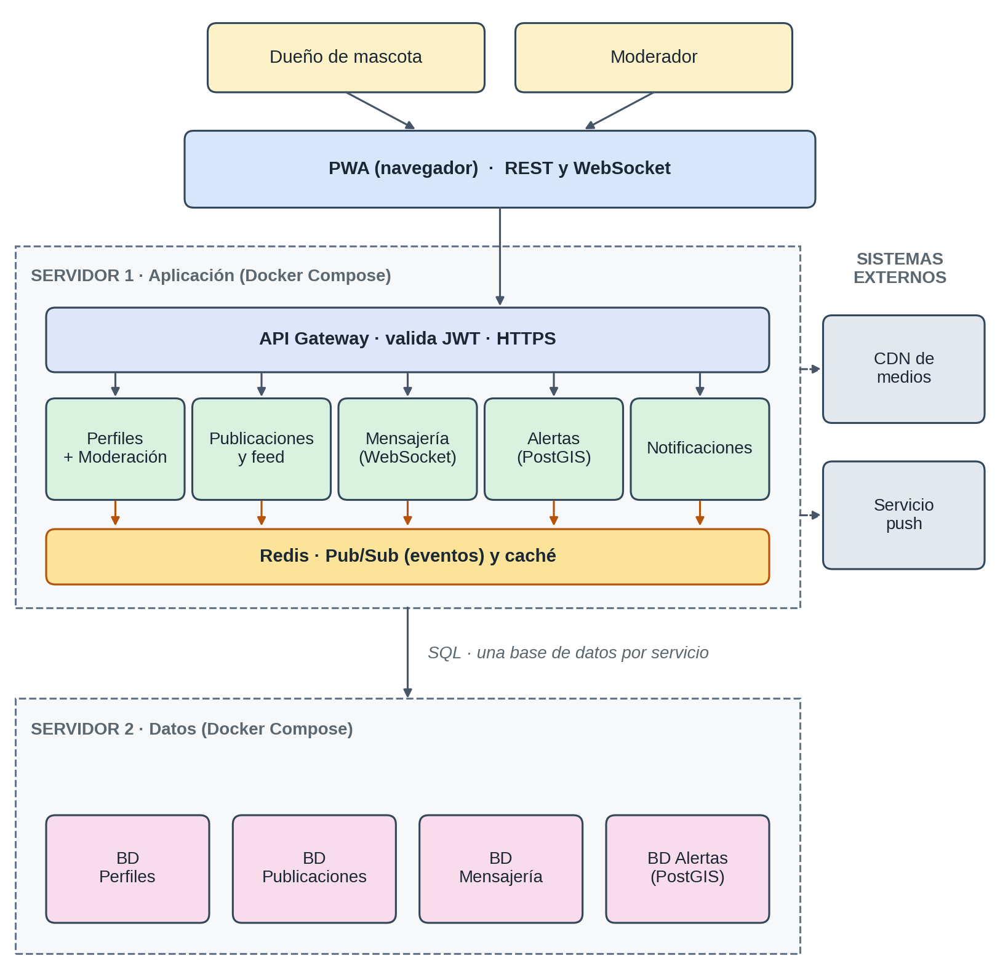

# Componentes arquitectónicos

| Componente | Responsabilidad | Tecnología propuesta | Hardware (pruebas) |
|---|---|---|---|
| **PWA** | Interfaz del dueño y del moderador. | React, Angular o Vue | Navegador moderno |
| **API Gateway** | Enrutamiento, validación de JWT y HTTPS. | NGINX o Node.js, Docker | 2 vCPU, 2 GB RAM |
| **Servicio de Perfiles** | Registro, inicio de sesión, emisión de JWT, perfiles, privacidad, verificación y módulo de Moderación y Reportes. | Spring Boot, Node.js (Express) o FastAPI | 1 vCPU, 1 GB RAM |
| **Servicio de Publicaciones** | Publicaciones, reacciones, comentarios y feed. | Ídem | 1 vCPU, 1 GB RAM |
| **Servicio de Mensajería** | Mensajes directos y canal WebSocket. | Ídem | 1 vCPU, 1 GB RAM |
| **Servicio de Alertas** | Reportes de mascota perdida, avistamientos, estados y búsqueda por radio. | Ídem | 1 vCPU, 1 GB RAM |
| **Servicio de Notificaciones** | Se suscribe a eventos y envía notificaciones push y alertas masivas de forma asíncrona. | Ídem | 1 vCPU, 1 GB RAM |
| **Redis** | Bus Pub/Sub y caché. | Redis | 1 vCPU, 1 GB RAM |
| **PostgreSQL + PostGIS** | Una base de datos por servicio. | PostgreSQL 15 con PostGIS | 2 vCPU, 4 GB RAM, SSD |
| **Almacenamiento de medios** | Fotos y videos servidos mediante CDN. | Cloudflare R2 o Supabase Storage | Gestionado |
| **CI/CD** | Pruebas, construcción de imágenes y despliegue. | Docker, Docker Compose, GitHub Actions | Según proveedor |
