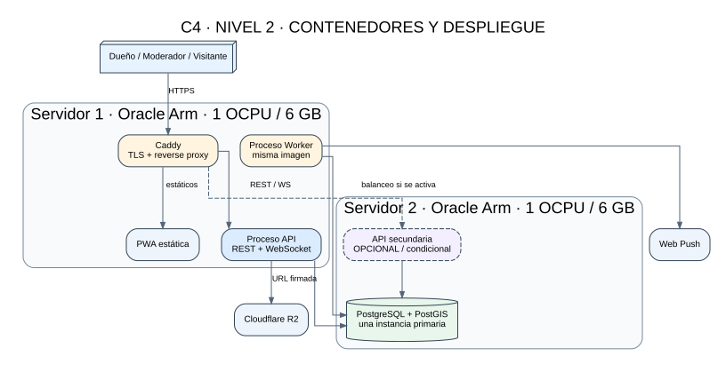

# Componentes arquitectónicos

| Componente | Tipo | Responsabilidad |
|---|---|---|
| PWA React | Cliente | Interfaz responsive, navegación y comunicación REST/WebSocket. |
| Caddy | Proxy inverso | TLS, compresión, límites de tasa y balanceo condicional entre procesos API. No contiene reglas de negocio. |
| API | Proceso del monolito | Punto de entrada REST/WS, autenticación y composición de seis módulos. |
| Worker | Proceso del monolito | Despacha Outbox, reintenta efectos diferidos y entrega notificaciones. |
| Módulos | Componentes lógicos | Identidad, Perfiles, Publicaciones, Mensajería, Alertas y Notificaciones. No se despliegan por separado. |
| PostgreSQL + PostGIS | Persistencia | Una instancia primaria con esquema por módulo y esquema técnico Outbox. |
| Cloudflare R2 | Servicio externo | Almacena medios con URL firmadas. |
| Web Push | Servicio externo | Entrega notificaciones push. |
| GitHub Actions | CI/CD | Ejecuta pruebas, construye imagen ARM y despliega por SSH. |

## Distribución física

- VM1: Caddy, estáticos PWA, API principal y worker.
- VM2: PostgreSQL/PostGIS. API secundaria opcional, solo tras medición y si no degrada la base.
