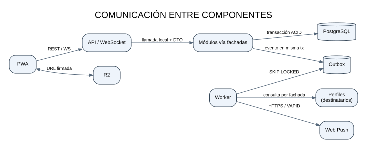

# Comunicación entre componentes

## Regla de selección del canal

- **Síncrono:** cuando el usuario necesita el resultado en la misma interacción. Se invoca la fachada pública del módulo y se devuelve un DTO.
- **Asíncrono:** cuando el efecto puede ocurrir después. Se registra un evento en Outbox dentro de la misma transacción del cambio de negocio; el worker lo procesa.
- **Tiempo real:** mensajería entre clientes por WebSocket, con persistencia previa del mensaje.
- **Persistencia:** SQL parametrizado mediante repositorios del módulo propietario.
- **Archivos:** URL firmada para transferir directamente a Cloudflare R2.

## Diagrama de comunicación

Fuente editable: `../diagramas/comunicacion-componentes.mmd`.

## Contratos

| Emisor → receptor | Canal / contrato | Garantías |
|---|---|---|
| PWA → API | HTTPS REST `/api/v1`, JSON, OpenAPI, errores RFC 9457 | JWT Bearer, validación, rate limit y paginación cursor. |
| PWA ↔ API | WebSocket `/ws` con mensajes JSON tipados | JWT en handshake, autorización por conversación, ping/pong y reconexión con backoff. |
| Módulo → módulo | Fachada pública + DTO inmutable | Llamada local, sin red, sin compartir tablas ni entidades. |
| Caso de uso → Outbox | Misma transacción PostgreSQL | Atomicidad entre cambio de negocio y evento. |
| Worker → consumidor | Dispatcher Outbox | Entrega al menos una vez; consumidor idempotente por `eventId`. |
| API/Worker → PostgreSQL | Repositorio del módulo | SQL parametrizado, transacción ACID y pool limitado. |
| PWA ↔ R2 | URL firmada HTTPS | API no transporta binarios; tipo MIME y tamaño validados. |
| Worker → Web Push | HTTPS + VAPID | Reintentos con backoff; dead-letter tras máximo de intentos. |

## Flujo: reporte de mascota perdida

1. La PWA envía `POST /api/v1/alertas` con JWT, ubicación y datos del reporte.
2. El controlador valida formato y autorización, y llama a `Alertas.reportar`.
3. El caso de uso valida reglas del Dominio.
4. En una sola transacción se inserta el reporte y el evento `MascotaPerdidaReportada` en `shared.outbox`.
5. La API devuelve `201 Created` con identificador y estado; no espera el envío push.
6. El worker toma eventos pendientes con `FOR UPDATE SKIP LOCKED`.
7. Notificaciones solicita a Perfiles los destinatarios dentro del radio, respetando consentimiento.
8. Se crea la notificación interna y se intenta Web Push. Cada intento queda registrado.
9. El worker marca el evento procesado; tras 5 intentos fallidos, lo mueve a dead-letter y genera registro/alerta operativa.

## Contrato de eventos

Todo evento contiene `eventId`, `eventType`, `occurredAt`, `aggregateId`, `schemaVersion` y `correlationId`. El payload incluye solo datos necesarios; no se publican credenciales ni coordenadas precisas innecesarias.

| Evento | Productor | Consumidor | Resultado |
|---|---|---|---|
| `UsuarioRegistrado` | Identidad | Perfiles | Inicializa el perfil del dueño. |
| `MascotaPerdidaReportada` | Alertas | Notificaciones | Avisa a usuarios elegibles en el radio. |
| `AvistamientoRegistrado` | Alertas | Notificaciones | Avisa al propietario. |
| `EstadoReporteCambiado` | Alertas | Notificaciones | Comunica cambio de estado. |
| `MensajeEnviado` | Mensajería | Notificaciones | Push si el receptor está desconectado. |
| `PublicacionCreada` | Publicaciones | Notificaciones (versión 1.1) | Aviso a seguidores, si la preferencia está activa. |

## Idempotencia y fallos

- La API acepta `Idempotency-Key` para operaciones críticas de creación de reporte.
- `eventId` es único en Outbox y en la tabla `eventos_procesados`.
- El dispatcher usa `FOR UPDATE SKIP LOCKED`; varios workers no reclaman simultáneamente la misma fila.
- Reintentos con espera creciente; máximo 5 intentos configurable.
- Los eventos fallidos quedan en dead-letter para inspección y reproceso manual controlado.
- Si el worker está detenido, la API sigue respondiendo y Outbox conserva el trabajo pendiente.
