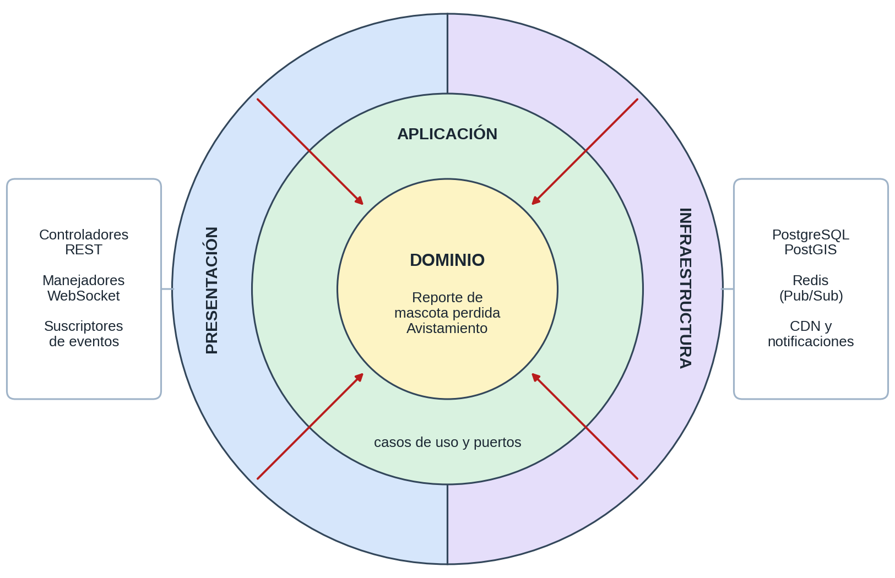

# Enfoque arquitectónico: Clean Architecture

| Elemento | Descripción aplicada a RimayPet |
|---|---|
| **Enfoque** | Clean Architecture, aplicada dentro de cada microservicio. |
| **Objetivo** | Separar responsabilidades y hacer que las dependencias apunten hacia el dominio. |
| **Problema que resuelve** | Evita que las reglas del negocio queden atadas a PostgreSQL, Redis, el CDN, el servicio push o el framework web. |
| **Capas** | Presentación, Aplicación, Dominio e Infraestructura. |
| **Beneficios** | Pruebas unitarias sin infraestructura; cambio de proveedor sin tocar el dominio; código ordenado para una sola persona. |

## Regla de dependencia

1. El dominio no importa nada de las demás capas.
2. Los casos de uso conocen entidades y puertos, pero no frameworks ni bases de datos.
3. Los adaptadores de infraestructura implementan los puertos (inversión de dependencias).
4. Cambiar de tecnología equivale a cambiar un adaptador y la composición.

## Carpetas y capas de cada microservicio

| Carpeta | Capa | Contenido |
|---|---|---|
| `domain/` | Dominio | Entidades, objetos de valor y reglas de negocio. |
| `application/` | Aplicación | Casos de uso, puertos y DTO. |
| `presentation/` | Presentación | Controladores REST, manejadores WebSocket y suscriptores de eventos. |
| `infrastructure/` | Infraestructura | Repositorios PostgreSQL/PostGIS, cliente Redis, cliente CDN y cliente push. |

## Profundidad de aplicación por servicio

| Servicio | Aplicación | Motivo |
|---|---|---|
| Alertas | Completa | Concentra reglas de negocio (radio, estados, validaciones). |
| Perfiles | Completa | Reglas de privacidad, seguridad y moderación. |
| Publicaciones | Ligera | Operaciones más cercanas a CRUD y feed. |
| Mensajería | Ligera | Predomina el manejo de conexiones. |
| Notificaciones | Ligera | Reacciona a eventos y delega en el servicio push. |

## Comparación con Arquitectura Hexagonal

| Aspecto | Clean Architecture | Hexagonal |
|---|---|---|
| Estructura | Capas concéntricas | Núcleo con puertos y adaptadores |
| Casos de uso | Capa propia (Aplicación) | Dentro del núcleo |
| Decisión | **Elegida**: cada historia de usuario se mapea a un caso de uso explícito y las cuatro capas facilitan la documentación. | Alternativa equivalente en la práctica; su idea de puertos y adaptadores se conserva. |

El ejemplo ejecutable está en [`tecnologia/boilerplate-clean-architecture`](../../tecnologia/boilerplate-clean-architecture).
