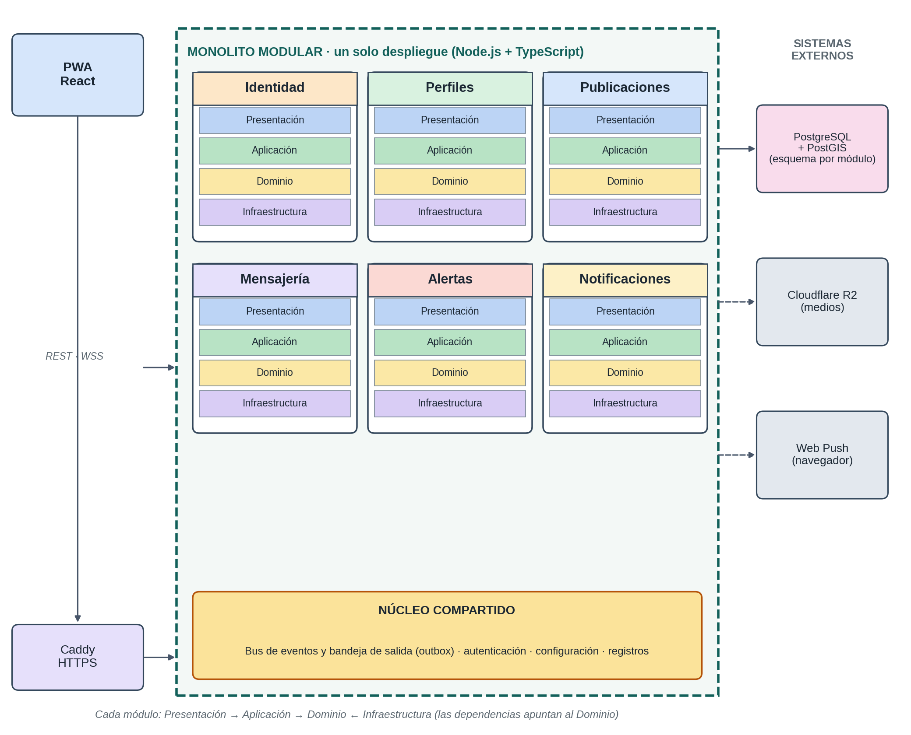

# Estilo arquitectónico: monolito modular

## Decisión

RimayPet adopta un **monolito modular**: una sola aplicación de negocio, un repositorio y un artefacto desplegable, internamente dividido en seis módulos con fronteras explícitas. La API HTTP/WebSocket y el worker son dos puntos de entrada del mismo código base; no son microservicios ni tienen ciclos de vida de negocio independientes.

El enfoque interno es **Clean Architecture por módulo**: Presentación, Aplicación, Dominio e Infraestructura. Las dependencias del código apuntan hacia el Dominio.

## Diagrama del estilo y enfoque

## Justificación

| Criterio | Monolito modular elegido | Microservicios | Monolito sin módulos |
|---|---|---|---|
| Operación con una persona | Un artefacto y un despliegue principal | Varios despliegues y redes | Simple |
| Uso de 2 OCPU y 12 GB | Ajustado al presupuesto | Mayor sobrecarga por procesos | Ajustado |
| Consistencia | Transacciones ACID dentro de PostgreSQL | Eventual y compensaciones | ACID |
| Fronteras de negocio | Explícitas y verificables | Explícitas por servicio | Difusas |
| Escalado | Réplica del proceso API completo y worker separado | Por servicio | Réplica total |
| Evolución | Se puede extraer un módulo cuando exista necesidad demostrada | Natural, pero costosa | Difícil por acoplamiento |

Los microservicios se descartan porque el costo de red, despliegue, observabilidad y operación no se justifica para un desarrollador y los recursos disponibles. No se descarta la evolución futura: un módulo podría extraerse aplicando el patrón Strangler cuando la carga, el equipo o el presupuesto lo justifiquen.

## Reglas de frontera

1. Cada módulo es dueño de su esquema PostgreSQL.
2. Ningún módulo consulta directamente tablas de otro esquema.
3. Las llamadas síncronas entre módulos se realizan solo mediante su fachada pública (`index.ts`) y DTO inmutables.
4. Los efectos diferidos se comunican mediante eventos persistidos en Outbox.
5. No se permiten ciclos en el grafo de dependencias.
6. El Dominio no importa frameworks, drivers, ORM ni SDK externos.
7. No se permite compartir entidades de Dominio entre módulos.
8. El núcleo `shared` contiene capacidades técnicas transversales, nunca reglas de negocio.

## Topología de procesos

- `main-api`: expone REST, WebSocket, autenticación y composición de módulos.
- `main-worker`: despacha Outbox y ejecuta notificaciones y tareas diferidas.
- Ambos se construyen desde el mismo repositorio y la misma imagen Docker; cambia el comando de arranque.
