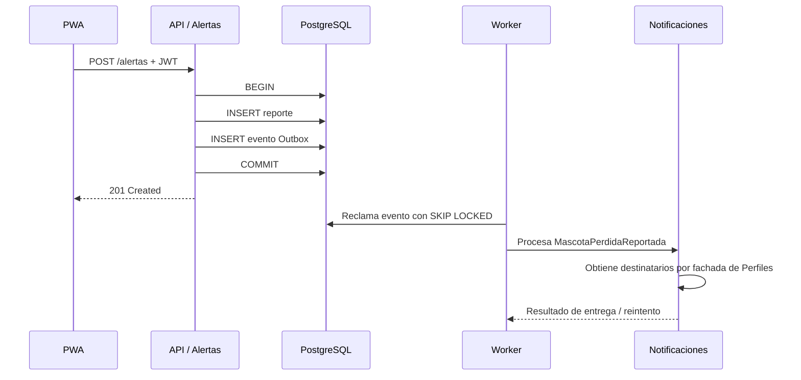

# Diseño interno de módulos

El sistema tiene seis módulos lógicos descritos en [`modulos-y-fronteras.md`](../../02-arquitectura-software/modulos-y-fronteras.md). Cada uno repite las cuatro capas de Clean Architecture y expone una única fachada pública.

## Corte vertical de referencia: Alertas

```text
modules/alertas/
├── domain/
│   ├── entities/ReporteMascotaPerdida.ts
│   └── value-objects/{Ubicacion,RadioBusqueda}.ts
├── application/
│   ├── use-cases/
│   │   ├── ReportarMascotaPerdida.ts
│   │   ├── RegistrarAvistamiento.ts
│   │   ├── ActualizarEstadoReporte.ts
│   │   └── ConsultarEstadoPublico.ts
│   └── ports/{RepositorioReportes,PublicadorEventos}.ts
├── presentation/http/AlertasController.ts
├── infrastructure/persistence/RepositorioReportesPostgres.ts
├── infrastructure/events/OutboxPostgres.ts
└── index.ts
```

## Reglas del Dominio

| Regla | Responsable |
|---|---|
| Latitud entre -90 y 90; longitud entre -180 y 180. | `Ubicacion` |
| Radio dentro del rango permitido por producto (propuesta inicial: 0,5 a 20 km). | `RadioBusqueda` |
| El reporte inicia en estado `PERDIDA`. | `ReporteMascotaPerdida` |
| Solo se permiten transiciones de estado válidas. | `ReporteMascotaPerdida` |
| Solo propietario o rol autorizado actualiza el reporte. | Caso de uso + política de autorización |

## Endpoints de referencia

| Método y ruta | Caso de uso | Acceso |
|---|---|---|
| `POST /api/v1/alertas` | ReportarMascotaPerdida | JWT |
| `POST /api/v1/alertas/{id}/avistamientos` | RegistrarAvistamiento | JWT |
| `PATCH /api/v1/alertas/{id}/estado` | ActualizarEstadoReporte | JWT + propietario |
| `GET /api/v1/alertas/{id}/estado-publico` | ConsultarEstadoPublico | Público limitado |

## Flujo de reporte



El ejemplo ejecutable está en `tecnologia/boilerplate-clean-architecture`; usa adaptadores en memoria para demostrar Dominio, Aplicación y puertos. La integración PostgreSQL/Outbox se implementará en el corte vertical del siguiente sprint.
