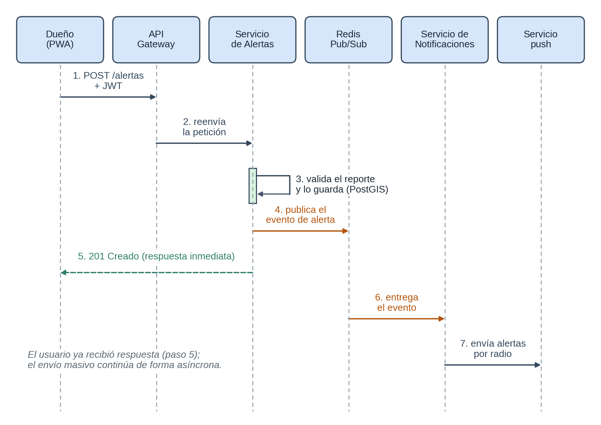
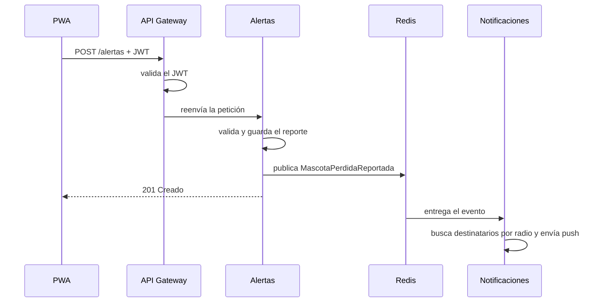

# Diseño interno de módulos

El diseño de software detalla **cómo se construyen** los componentes definidos por la arquitectura. Se desarrolla en profundidad el servicio de **Alertas**, el más exigente (RF05 y RF06), y se resumen los demás.

## Servicio de Alertas

### Estructura de carpetas

```text
alertas/
├── domain/
│   ├── ReporteMascotaPerdida.js
│   ├── Avistamiento.js
│   ├── Ubicacion.js           (objeto de valor)
│   └── RadioBusqueda.js       (objeto de valor)
├── application/
│   ├── casos-de-uso/
│   │   ├── ReportarMascotaPerdida.js
│   │   ├── RegistrarAvistamiento.js
│   │   ├── ActualizarEstadoReporte.js
│   │   └── ConsultarEstadoPublico.js
│   └── ports/
│       ├── RepositorioReportes.js
│       └── PublicadorEventos.js
├── infrastructure/
│   ├── RepositorioReportesPostGIS.js
│   └── PublicadorRedis.js
└── presentation/
    └── AlertasController.js
```

> El ejemplo ejecutable de `tecnologia/` implementa `ReportarMascotaPerdida` y `ConsultarEstadoPublico`, con adaptadores en memoria. Los demás casos de uso y adaptadores de este árbol son el diseño objetivo del servicio.

### Reglas del dominio

| Regla | Dónde vive |
|---|---|
| La ubicación debe tener latitud entre -90 y 90 y longitud entre -180 y 180. | `Ubicacion` |
| El radio de búsqueda debe estar entre 0,5 y 20 km (por defecto, 5 km). | `RadioBusqueda` |
| Un reporte nace en estado `perdida`; solo puede pasar a `avistada` o `encontrada`. | `ReporteMascotaPerdida` |
| Un reporte encontrado no puede volver a `perdida`. | `ReporteMascotaPerdida` |

### Endpoints (presentación)

| Método y ruta | Caso de uso | Acceso |
|---|---|---|
| `POST /alertas` | ReportarMascotaPerdida | Con JWT |
| `POST /alertas/{id}/avistamientos` | RegistrarAvistamiento | Con JWT |
| `PATCH /alertas/{id}/estado` | ActualizarEstadoReporte | Con JWT (solo el dueño) |
| `GET /alertas/{id}/estado` | ConsultarEstadoPublico | Público (sin sesión) |

### Eventos publicados

| Evento | Contenido | Consumidor |
|---|---|---|
| `MascotaPerdidaReportada` | id del reporte, ubicación, radio, nombre y foto de la mascota | Notificaciones |
| `AvistamientoRegistrado` | id del reporte, id del dueño | Notificaciones |

### Flujo: reportar una mascota perdida





## Resumen de los demás servicios

| Servicio | Entidades | Casos de uso principales | Puertos principales |
|---|---|---|---|
| Perfiles | Dueño, Mascota, Privacidad, Verificación, ReporteModeración | RegistrarDueño, IniciarSesión, CrearPerfilMascota, ConfigurarPrivacidad, SuspenderCuenta, GenerarReporteActividad | RepositorioPerfiles, EmisorToken, Hasheador, BitácoraAuditoría |
| Publicaciones | Publicación, Comentario, Reacción, Seguimiento | PublicarContenido, ObtenerFeed, Reaccionar, Comentar | RepositorioPublicaciones, AlmacenMedios, PublicadorEventos, CachéFeed |
| Mensajería | Conversación, Mensaje | EnviarMensaje, ListarConversación, MarcarLeído | RepositorioMensajes, PublicadorEventos, RegistroConexiones |
| Notificaciones | Notificación, Destinatario | ProcesarAlertaMasiva, NotificarMensaje, NotificarInteracción | ConsultaDestinatarios (hacia Perfiles), ServicioPush |
