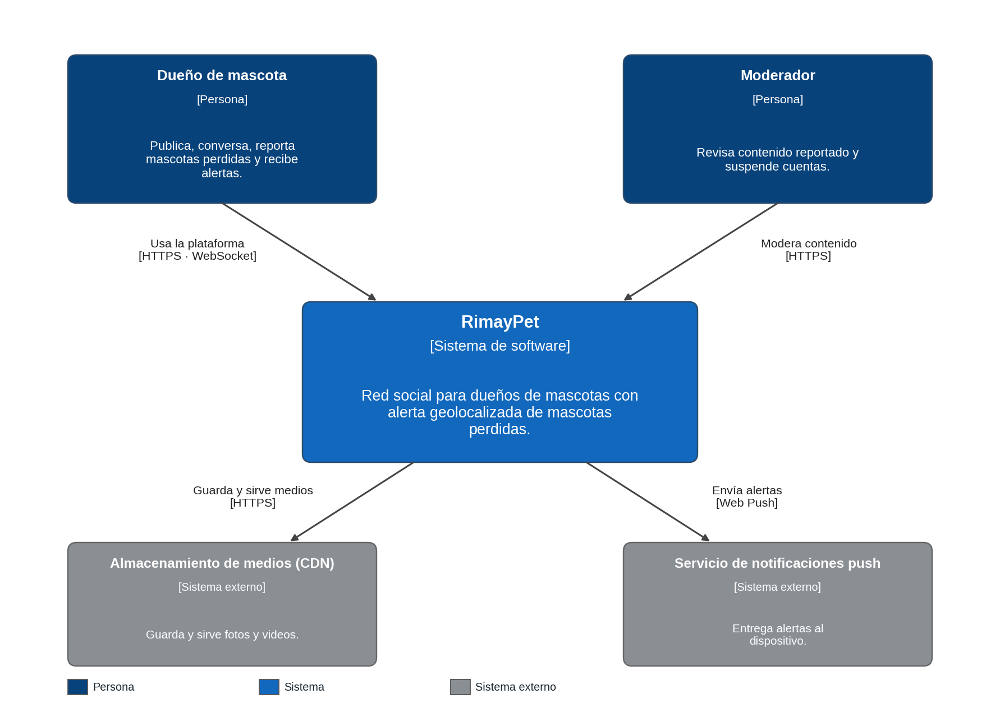

# C4 · Nivel 1: diagrama de contexto del sistema

Muestra RimayPet en su entorno: quiénes lo usan y con qué sistemas externos se relaciona.

| Elemento | Tipo | Descripción |
|---|---|---|
| Dueño de mascota | Persona | Publica, conversa, reporta mascotas perdidas y recibe alertas. |
| Moderador | Persona | Revisa contenido reportado y suspende cuentas. |
| RimayPet | Sistema de software | Red social con alerta geolocalizada de mascotas perdidas. |
| Almacenamiento de medios (CDN) | Sistema externo | Guarda y sirve fotos y videos. |
| Servicio de notificaciones push | Sistema externo | Entrega alertas al dispositivo del usuario. |

**Trazabilidad:** dueño (HU01–HU05), moderador (HU06), CDN (RF02) y push (RF06).
