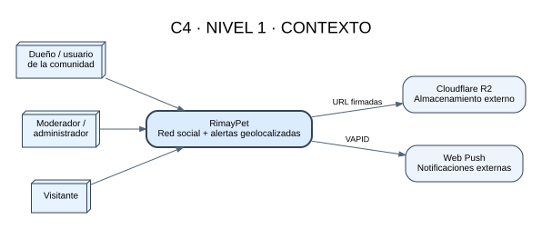
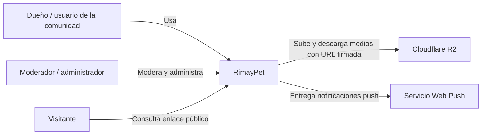

# C4 — Nivel 1: contexto del sistema

| Elemento | Tipo | Responsabilidad |
|---|---|---|
| Dueño / usuario | Persona | Gestiona mascotas, publica, conversa y reporta pérdidas. |
| Moderador / administrador | Persona | Revisa reportes y administra la comunidad. |
| Visitante | Persona | Consulta únicamente información pública compartida. |
| RimayPet | Sistema | Red social y plataforma de alertas geolocalizadas. |
| Cloudflare R2 | Sistema externo | Almacena medios mediante URLs firmadas. |
| Web Push | Sistema externo | Entrega notificaciones a dispositivos suscritos. |
