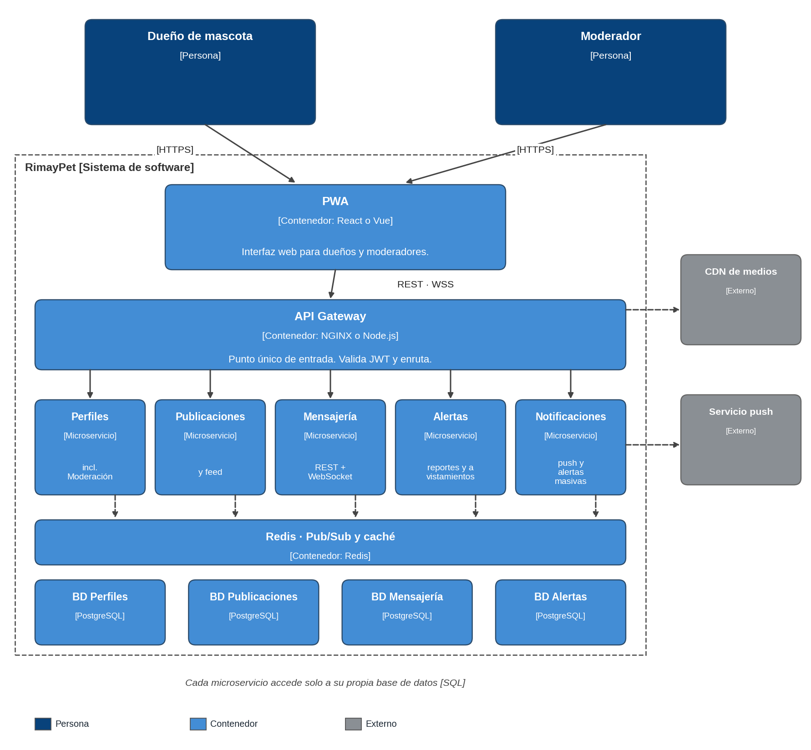

# C4 · Nivel 2: diagrama de contenedores

Muestra las aplicaciones, servicios y almacenes de datos que componen RimayPet y cómo se comunican.

| Contenedor | Tecnología | Responsabilidad | Requisitos |
|---|---|---|---|
| PWA | React o Vue | Interfaz del dueño y del moderador. | RF01–RF08 |
| API Gateway | NGINX o Node.js | Punto único de entrada; valida JWT y enruta. | RC04, DA03 |
| Servicio de Perfiles | Spring Boot, Node.js o FastAPI | Cuentas, JWT, perfiles y moderación. | RF01, RF07, RF08 |
| Servicio de Publicaciones | Ídem | Publicaciones y feed. | RF02, RF03 |
| Servicio de Mensajería | Ídem | Mensajes y WebSocket. | RF04 |
| Servicio de Alertas | Ídem | Reportes y avistamientos. | RF05, RF06 |
| Servicio de Notificaciones | Ídem | Envío de alertas y notificaciones. | RF06 |
| Redis | Redis | Bus Pub/Sub y caché. | DA02 |
| Bases de datos | PostgreSQL (PostGIS en Alertas y Perfiles) | Una base por servicio. | ADR-005 |

**Decisión de diseño:** Notificaciones no tiene base propia; para saber a quién avisar consulta a Perfiles los usuarios dentro del radio (ubicación aproximada y suscripción push). Perfiles usa PostGIS para esa consulta.
