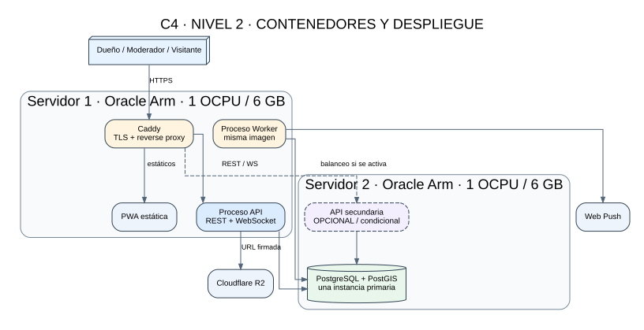
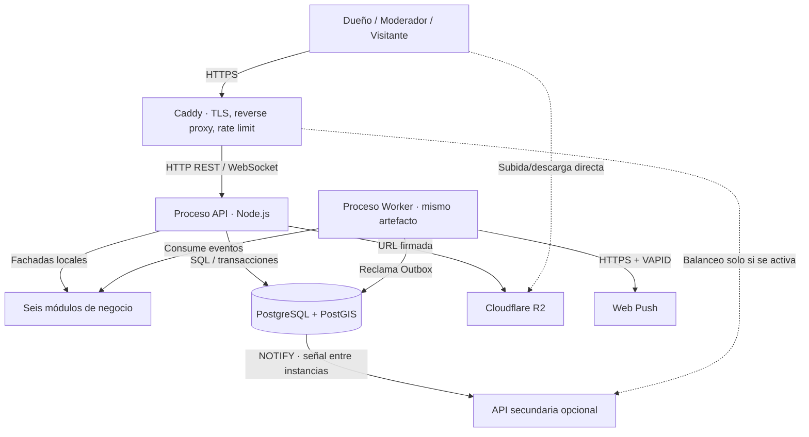

# C4 — Nivel 2: contenedores

El monolito modular se despliega como una aplicación con dos procesos (API y worker) construidos desde el mismo código. PostgreSQL es el único almacén relacional; los esquemas están separados por módulo.

| Contenedor | Tecnología | Responsabilidad |
|---|---|---|
| PWA | React | Interfaz responsive e instalable. |
| Caddy | Caddy | TLS, reverse proxy, compresión, rate limit y distribución HTTP. |
| Proceso API | Node.js / TypeScript | REST, WebSocket, autenticación, composición de módulos. |
| Proceso Worker | Node.js / TypeScript | Outbox, notificaciones y tareas diferidas. Mismo código/imagen que API. |
| PostgreSQL + PostGIS | PostgreSQL | Una instancia primaria; esquemas por módulo, índices geoespaciales y Outbox. |
| Cloudflare R2 | Object Storage | Fotos y videos; transferencia directa con URL firmada. |
| Web Push | VAPID | Entrega push a navegadores suscritos. |

## Despliegue físico

- **Servidor 1:** Caddy, PWA, API principal y worker.
- **Servidor 2:** PostgreSQL/PostGIS; API secundaria opcional detrás de Caddy si la CPU de la base mantiene margen.
- No se separa cada módulo en un contenedor ni en un servicio.
