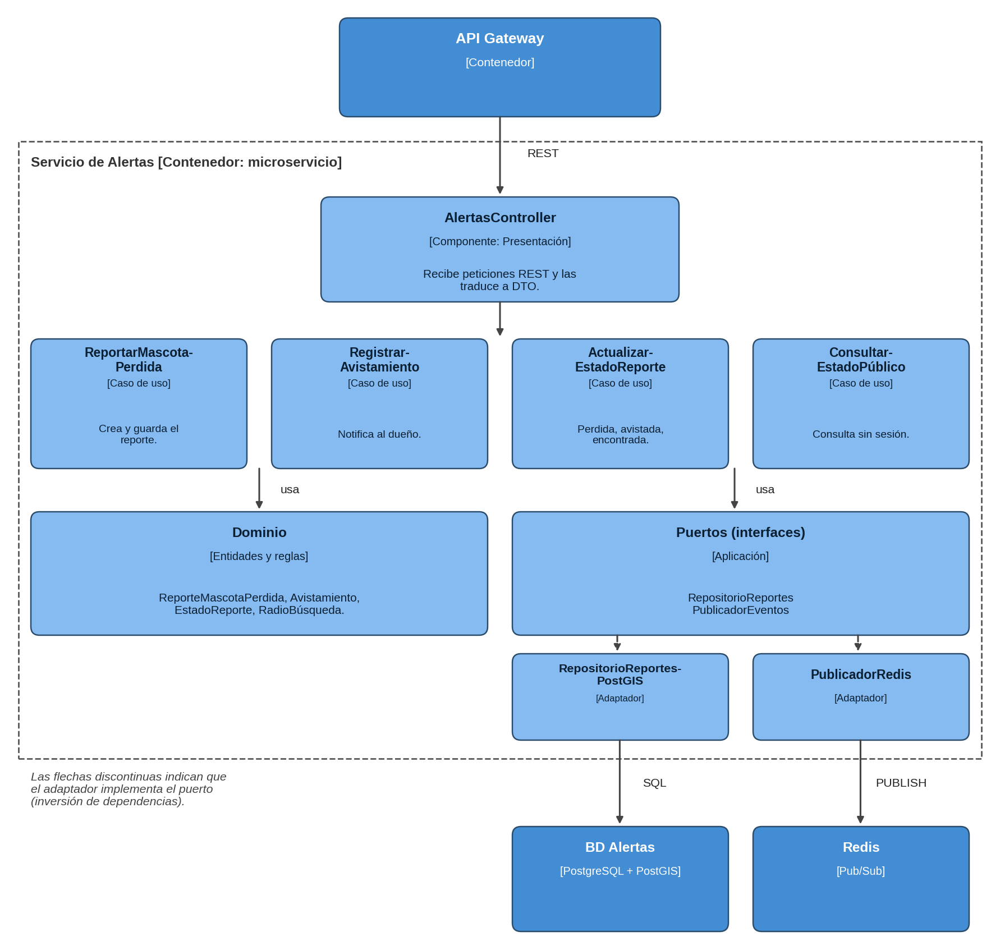

# C4 · Nivel 3: diagrama de componentes (servicio de Alertas)

Muestra los componentes internos de un contenedor. Se detalla el servicio de **Alertas** porque concentra las reglas más importantes y es el que mejor ilustra Clean Architecture.

| Componente | Capa | Responsabilidad |
|---|---|---|
| AlertasController | Presentación | Recibe peticiones REST y las traduce a DTO. |
| ReportarMascotaPerdida | Aplicación | Crea el reporte, lo guarda y publica el evento. |
| RegistrarAvistamiento | Aplicación | Registra un avistamiento y avisa al dueño. |
| ActualizarEstadoReporte | Aplicación | Cambia el estado (perdida, avistada, encontrada). |
| ConsultarEstadoPublico | Aplicación | Consulta el estado sin sesión. |
| ReporteMascotaPerdida, Avistamiento, EstadoReporte, RadioBusqueda | Dominio | Entidades y reglas del negocio. |
| RepositorioReportes, PublicadorEventos | Aplicación (puertos) | Contratos hacia el exterior. |
| RepositorioReportesPostGIS | Infraestructura | Implementa el repositorio sobre PostGIS. |
| PublicadorRedis | Infraestructura | Implementa el publicador sobre Redis. |

**Trazabilidad:** ReportarMascotaPerdida ← RF05, RF06 ← HU04; ConsultarEstadoPublico ← RF05; RegistrarAvistamiento ← RF05.

> Los demás servicios siguen la misma estructura de carpetas (ver `docs/02-arquitectura-software/enfoque-arquitectonico.md`).
