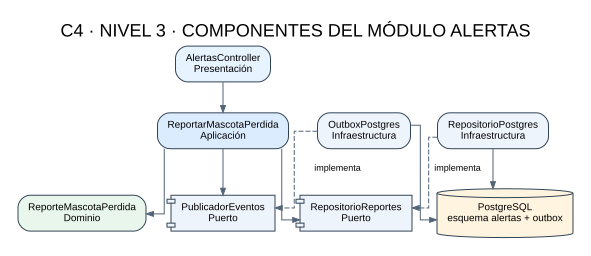
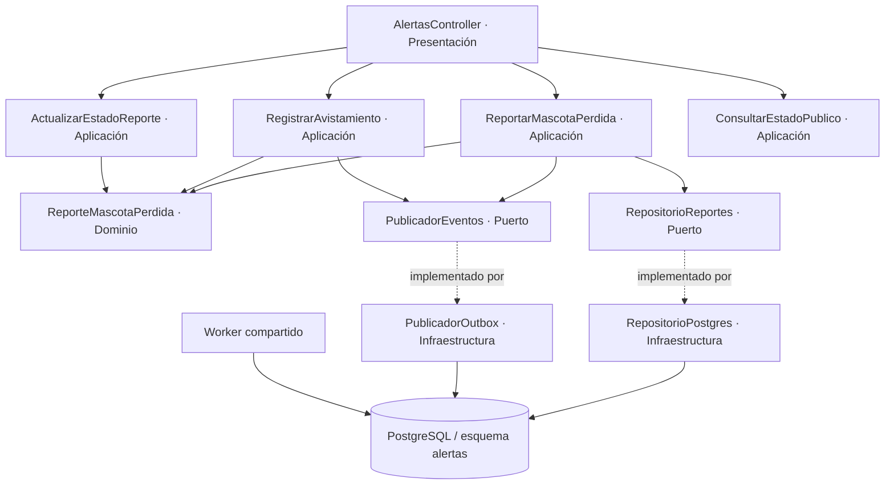

# C4 — Nivel 3: componentes del módulo Alertas

| Componente | Capa | Responsabilidad |
|---|---|---|
| AlertasController | Presentación | Validar DTO HTTP y traducir respuesta. |
| ReportarMascotaPerdida | Aplicación | Orquestar validación, persistencia y evento. |
| RegistrarAvistamiento | Aplicación | Registrar avistamiento y producir evento. |
| ActualizarEstadoReporte | Aplicación | Validar transición y cambiar estado. |
| ConsultarEstadoPublico | Aplicación | Exponer solo campos públicos autorizados. |
| ReporteMascotaPerdida, Ubicacion, RadioBusqueda | Dominio | Reglas, invariantes y estados. |
| RepositorioReportes | Puerto | Contrato de persistencia. |
| PublicadorEventos | Puerto | Contrato para registrar evento en Outbox. |
| RepositorioPostgres | Infraestructura | Implementación SQL/PostGIS. |
| PublicadorOutbox | Infraestructura | Inserta evento dentro de la misma transacción. |
