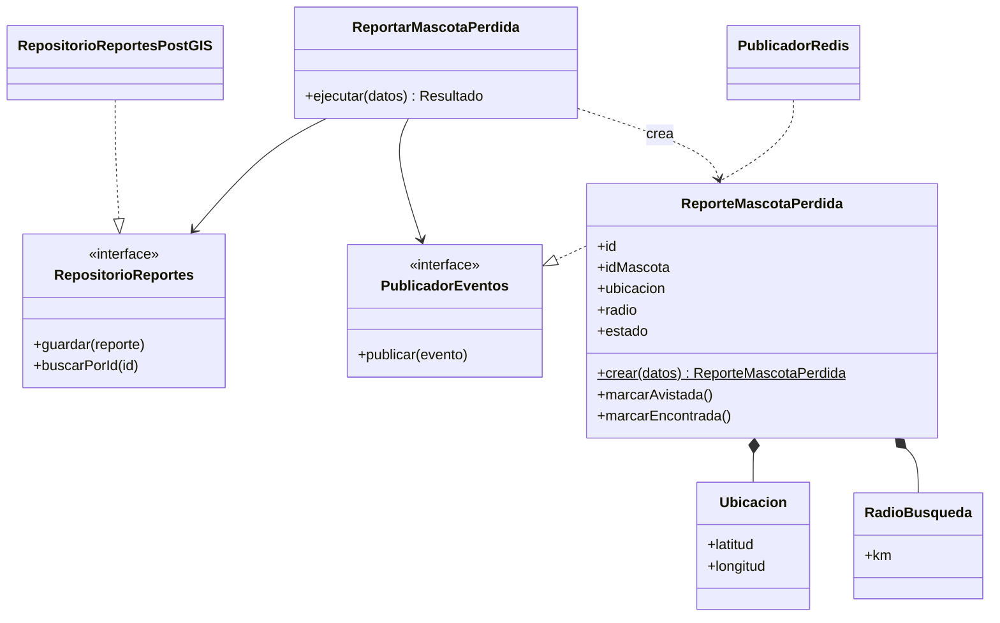

# C4 · Nivel 4: diagrama de código

Muestra la estructura interna del caso de uso `ReportarMascotaPerdida`: clases, interfaces y métodos.

El código ejecutable del caso de uso está en `tecnologia/boilerplate-clean-architecture/src/alertas/application/casos-de-uso/ReportarMascotaPerdida.js`.
