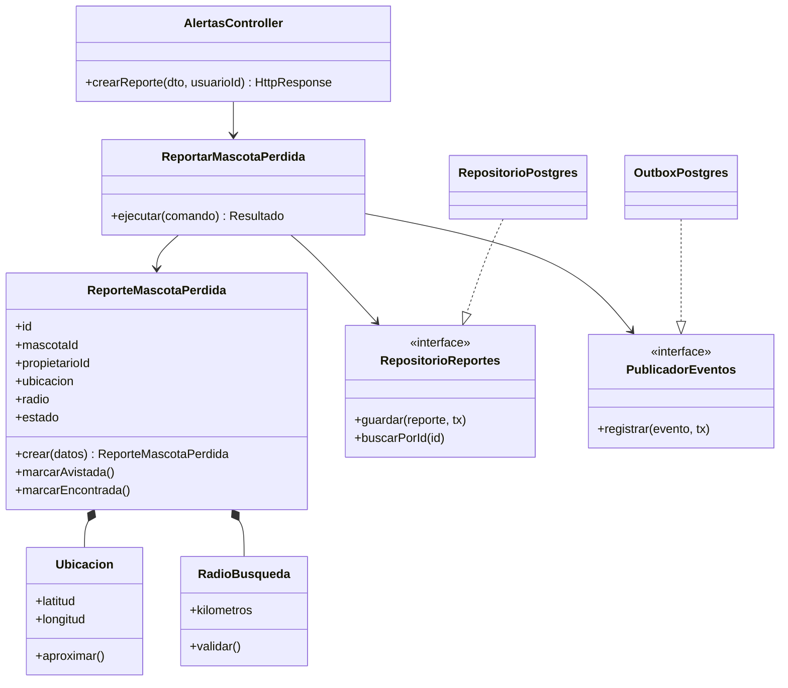

# C4 — Nivel 4: código del caso de uso ReportarMascotaPerdida

La transacción la coordina el adaptador de persistencia/unidad de trabajo: guarda el reporte y la fila Outbox en la misma transacción. La API no publica directamente a Redis ni realiza el push.
